# Отчёт по практической работе

## «Принципы работы с растровыми изображениями»

**Учебное заведение:** Саратовский государственнный технический университет Гагарина Ю.А  
**Дисциплина:**  Методы обработки сигналов и изображений  
**Выполнил(а):** Карпов Егор Дмитриевич  
**Группа:** М1-ИФСТ-22  
**Преподаватель:** Пиминов Д.А.  
**Город:** Саратов /n
**Год:** 2026

---

## Цель работы

Изучить представление растровых данных, цветовые модели, яркостные и морфологические преобразования, выделение границ и признаков, сравнение изображений и обработку видео. Разработать GUI-приложение и проверить его на воспроизводимых данных.

# Часть 1. Теоретические сведения

## 1. Глубина цвета и анализ изображений

Растровое изображение представляет собой прямоугольную сетку пикселей. **Глубина цвета** — число бит, выделяемых для представления цвета одного пикселя. Следует отличать бит/пиксель от бит/канал: RGB с 8 битами на канал имеет глубину 24 бита/пиксель. При b битах возможно до 2^b различных кодов. В индексированном изображении код обозначает элемент палитры; в RGBA часть битов описывает прозрачность, а не дополнительные цвета.

Для RGB число возможных цветов равно 2^(bR+bG+bB). Объём несжатых данных без служебных полей приблизительно равен W·H·b/8 байт. Размер файла дополнительно зависит от сжатия, палитры, метаданных и структуры изображения.

### Практический эксперимент

Скриптом `python tools/make_examples.py` создан исходный рисунок 384×256: плавные цветовые переходы, геометрические фигуры и текст. Из одного оригинала получены шесть PNG. Данные ниже измерены программно, полный протокол — `examples/depth_analysis.csv`. MSE рассчитана по декодированным RGB-компонентам относительно исходника: MSE = Σ(I−J)²/(3WH).
Чем больше бит выделено на пиксель, тем шире палитра и плавнее переходы между оттенками. Количество цветов рассчитывается по формуле N = 2^i, где i — это количество бит на пиксель. Например:

1 бит на пиксель даёт 2 цвета (чёрный и белый).

8 бит на пиксель позволяет отобразить 256 оттенков серого или 16,7 миллиона цветов в RGB-модели (по 8 бит на каждый из трёх каналов: красный, зелёный, синий). 

10 бит на пиксель (или 10 бит на канал) — уже 1024 оттенка на канал, что даёт около 1 миллиарда цветов. 

| Представление | Бит/пиксель | Размер файла, байт | Различных RGB-цветов |    MSE (среднеквадратичная ошибка) |
|---|---:|---:|---:|----------:|
| Бинарное, порог 128 | 1 | 769 | 2 | 12147,390 |
| Индексированное, 16 цветов | 4 | 2507 | 16 |   378,658 |
| Оттенки серого | 8 | 6196 | 256 |  3506,542 |
| Индексированное, до 256 цветов | 8 | 7232 | 251 |    13,059 |
| RGB | 24 | 6006 | 58210 |         0 |
| RGBA, непрозрачный альфа-канал | 32 | 6599 | 58210 |         0 |


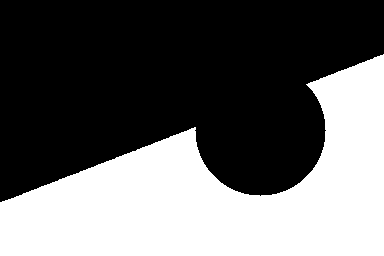

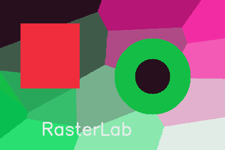

**Выводы.** При 1 бите теряются цвет и плавные переходы; сохраняется грубая структура. Палитра из 16 цветов создаёт заметные ступени на градиентах. 8-битная палитра существенно уменьшает ошибку. 8-битное серое изображение передаёт яркость, но полностью теряет информацию о цветности. RGB сохраняет оригинал. Непрозрачный альфа-канал увеличивает глубину до 32 бит, но не количество наблюдаемых цветов. В эксперименте 24-битный PNG меньше 8-битного палитрового: глубина не определяет размер сжатого файла однозначно. MSE между цветным и серым вариантами отражает также удаление цвета, поэтому не является универсальной оценкой визуального качества.

## 2. Цветовые модели и формулы преобразований

Любой перевод между поддерживаемыми моделями выполняется через RGB: A → RGB → B. Ниже RGB означает sRGB-компоненты с нелинейным кодированием, если явно не указано линейное RGB. Для формул HSL, HSV и CMYK принимаем r=R/255, g=G/255, b=B/255. Вычисления выполняются с плавающей точкой; ограничения диапазона и округление применяются в конце.

### RGB ↔ CMYK

RGB — аддитивная модель: красный, зелёный, синий(Цвета создаются путём сложения световых волн: чем больше света, тем ярче.).
CMYK — субтрактивная модель печати: голубой, пурпурный, жёлтый, чёрный(Здесь цвета формируются за счёт поглощения (вычитания) света красками на белой бумаге. Чем больше краски наносится, тем темнее цвет. Белый — это отсутствие краски (белая бумага), а чёрный цвет в CMYK — отдельная чёрная краска (Key), потому что смешение CMY даёт грязный оттенок).

- K(значение черного ключа) = 1 − max(r,g,b).
- При K < 1: C = (1−r−K)/(1−K), M = (1−g−K)/(1−K), Y = (1−b−K)/(1−K).
- При K = 1(цвет черный): C=M=Y=0, K=1.
- Обратно: r=(1−C)(1−K), g=(1−M)(1−K), b=(1−Y)(1−K).

В интерфейсе CMYK показан в процентах. Это учебное приближение; реальное преобразование для печати зависит от бумаги, красок, чёрной генерации и ICC-профилей.

### RGB → HSL и HSV

Обе модели используют тон H(HUE -(от 0 до 360°, где 0° — красный)), 
насыщенность S(Saturation насыщенность (от 0% до 100%, где 100% — чистый цвет).) 
и компоненту светлоты L(Lightness (L) — светлота (от 0% до 100%, где 0% — чёрный, 50% — нейтральный цвет, 100% — белый).)
либо значения VValue (V) — яркость (от 0% до 100%, где 100% — максимальная яркость).

В HSV при Value = 100% цвет становится белым, а не остаётся насыщенным.

Обозначим M=max(r,g,b), m=min(r,g,b), Δ=M−m.

- При Δ=0: H=0 по соглашению; фактически тон ахроматического цвета не определён.
- Если M=r: H=60·(((g−b)/Δ) mod 6). Максимальное значение — это красный канал. Разность (g − b) показывает отличие зелёного от синего. Деление на Δ (размах) нормализует эту разницу, а операция mod 6 обеспечивает результат в диапазоне [0, 6), что удобно для цветового круга. умножение на 60 переводит тон в градусы
- Если M=g: H=60·((b−r)/Δ+2). доминирует зелёный канал. Разность (b − r) показывает отличие синего от красного. Добавление 2 и умножение на 60 корректирует положение в цветовом круге.
- Если M=b: H=60·((r−g)/Δ+4).  синий канал. Разность (r − g) показывает отличие красного от синего. Добавление 4 и умножение на 60 завершает настройку положения в цветовом пространстве.

Для HSV:

- V=M. V = M. Здесь V — это Value (яркость), а M — максимальное значение из трёх цветовых каналов RGB (R', G', B'). То есть V показывает, насколько ярким является цвет. 
- S=0 при M=0; иначе S=Δ/M. Это формула для Saturation (насыщенности).
- Δ (дельта) — это разница между максимальным (M) и минимальным значением среди трёх каналов: Δ = max – min. Она показывает, насколько сильно цвета в этой точке отличаются по тону.
Если максимальное значение (M) равно нулю, это значит, что все три канала равны нулю. В таком случае цвет воспринимается как серый (или его оттенки — белый/чёрный в зависимости от яркости V). Поэтому насыщенность логично принять за ноль.
Если M не ноль, то насыщенность вычисляется как отношение разницы тонов (Δ) к максимальному значению (M). Так цвет нормализуется, и значение S лежит в диапазоне от 0 до 1 (или в процентах — от 0% до 100%).

Для HSL:

- L=(M+m)/2. Светлота Здесь max и min — максимальное и минимальное значения из трёх цветовых каналов (например, R, G, B в модели RGB), а L представляет собой среднее арифметическое этих двух значений, то есть среднюю яркость цвета. Значение L лежит в диапазоне от 0 (чёрный) до 1 (белый). 
- S=0 при Δ=0; иначе S=Δ/(1−|2L−1|). насыщенность Случай Δ = 0. Если разница между максимальным и минимальным значением каналов равна нулю, это означает, что все три канала имеют одинаковое значение. Такой цвет является ахроматическим (серым, белым или чёрным), и его насыщенность по определению равна нулю.
Расчёт при Δ ≠ 0. Формула для S зависит от значения L:
Если L ≤ 0.5, то S = Δ / (max + min).
Если L > 0.5, то S = Δ / (2 − max − min).

В интерфейсе H выражается в градусах [0,360], S,L,V — в процентах. H=360 эквивалентен H=0.

### HSL и HSV → RGB

Для HSV: C=V·S вычисляется цветность, m₀=V−C - смещение.  
Для HSL: C=(1−|2L−1|)·S - цветность, m₀=L−C/2 - смещение. 


В обоих случаях h=(H mod 360)/60, X=C·(1−|h mod 2−1|). Выбирается промежуточная тройка:

| Интервал h | (r′,g′,b′) |
|---|---|
| [0,1) | (C,X,0) |
| [1,2) | (X,C,0) |
| [2,3) | (0,C,X) |
| [3,4) | (0,X,C) |
| [4,5) | (X,0,C) |
| [5,6) | (C,0,X) |

Затем (r,g,b)=(r′+m₀,g′+m₀,b′+m₀), (R,G,B)=255·(r,g,b).

### RGB ↔ CIELAB через XYZ

CIELAB описывает светлоту L*, зелёно-красную ось a* и сине-жёлтую ось b*. Используются белая точка D65, наблюдатель 2°. Это приблизительно перцептивно равномерная модель.

1. Линеаризация каждого нормированного sRGB-компонента u:

   u_lin = u/12,92 при u≤0,04045; иначе u_lin=((u+0,055)/1,055)^2,4.

2. Переход в XYZ:

```text
[X]   [0.4124564  0.3575761  0.1804375] [r_lin]
[Y] = [0.2126729  0.7151522  0.0721750] [g_lin]
[Z]   [0.0193339  0.1191920  0.9503041] [b_lin]
```

3. Нормировка на белую точку (Xn,Yn,Zn)=(0,95047;1;1,08883). убираем «нейтральный» цвет Смысл операции X/Xn, Y/Yn, Z/Zn: белый цвет монитора (D65) должен в Lab дать ровно L* = 100, a* = b* = 0. Нормировка сдвигает всю систему так, чтобы эталонный белый оказался в точке (1; 1; 1).
в темноте мы различаем оттенки гораздо лучше, чем на ярком свету (закон Стивенса, показатель ≈ 1/3).
   
4. δ=6/29. f(t)=t^(1/3) при t>δ³; иначе f(t)=t/(3δ²)+4/29.

   L*=116f(Y/Yn)−16;  
   a*=500[f(X/Xn)−f(Y/Yn)];  
   b*=200[f(Y/Yn)−f(Z/Zn)].

4. Обратное преобразование:

   fy=(L*+16)/116, fx=fy+a*/500, fz=fy−b*/200.  
   f⁻¹(q)=q³ при q>δ; иначе f⁻¹(q)=3δ²(q−4/29).  
   (X,Y,Z)=(Xn·f⁻¹(fx), Yn·f⁻¹(fy), Zn·f⁻¹(fz)).

5. Обратно в линейное RGB:

```text
[r_lin]   [ 3.2404542 -1.5371385 -0.4985314] [X]
[g_lin] = [-0.9692660  1.8760108  0.0415560] [Y]
[b_lin]   [ 0.0556434 -0.2040259  1.0572252] [Z]
```

6. Кодирование sRGB: u=12,92u_lin при u_lin≤0,0031308; иначе u=1,055u_lin^(1/2,4)−0,055. Результат ограничивается [0,1] и умножается на 255.

Некоторые цвета Lab лежат вне охвата sRGB: после ограничения обратное преобразование необратимо. В программе L* задаётся в [0,100], a*,b* — в распространённом учебном диапазоне [−128,127]; теоретически Lab не ограничен этим диапазоном a*,b*. Внутри вычислений используются действительные значения Lab, а не кодировка OpenCV Lab uint8.


Lab описывает почти все видимые человеком цвета, а sRGB — маленький треугольник внутри видимой области. Значит, существуют корректные Lab-цвета, у которых обратное преобразование даёт линейный RGB, скажем, 1,3 или −0,2 — такого цвета на экране просто нет.

Зажим в [0, 1] — вынужденная мера, и он необратим: прокрутив зажатый RGB обратно в Lab, вы получите другой (менее насыщенный) цвет. Практический приём, если это критично: не зажимать каналы по отдельности, а уменьшать насыщенность в самом Lab (сжимать a*, b* к нулю при сохранении L* и оттенка), пока цвет не влезет в охват целиком.


### RGB ↔ YCbCr (YCC)

Y — сигнал яркости (luma), Cb и Cr — цветоразностные компоненты. Используется полноразмаховый вариант BT.601 для RGB 0…255, без видеодиапазона 16…235:

```text
Y  =  0.299000R + 0.587000G + 0.114000B
Cb = -0.168736R - 0.331264G + 0.500000B + 128
Cr =  0.500000R - 0.418688G - 0.081312B + 128

R ≈ Y + 1.402000(Cr-128)
G ≈ Y - 0.344136(Cb-128) - 0.714136(Cr-128)
B ≈ Y + 1.772000(Cb-128)
```

Программа использует обратную матрицу для согласованности коэффициентов. Компоненты ограничиваются диапазоном [0,255]. На крайних насыщенных цветах формула может дать 255,5; ограничение до 255 приводит к небольшой потере точности (менее единицы RGB в проверенных контрольных примерах). YCbCr не тождественна аналоговой YUV. Y также не является физической линейной яркостью.

## 3. Яркостные преобразования

**Яркостные преобразования** — изменение интенсивностей пикселей по функции s=T(r), глобально одинаковой либо зависящей от локальной области. Они используются для улучшения видимости деталей, коррекции экспозиции и контраста.

- Смещение яркости: s=clip(r+β).
- Контраст относительно центра: s=clip(α(r−127,5)+127,5).
- Линейное растяжение диапазона: s=255(r−r_min)/(r_max−r_min). Постоянное изображение требует отдельной обработки; в программе сохраняется без изменения.
- Инверсия: s=255−r.
- Гамма-коррекция: s=255(r/255)^γ. В этой договорённости γ<1 осветляет, γ>1 затемняет.
- Логарифмическое преобразование: s=255·ln(1+r)/ln(256), расширяет тёмные значения.
- Пороговое преобразование: два уровня по сравнению с порогом.
- Эквализация: s≈255·CDF(r), перераспределяет уровни по накопленной гистограмме.
- Локальная эквализация CLAHE обрабатывает отдельные области с ограничением усиления контраста.

Изменение насыщенности — цветовое, а не чисто яркостное преобразование: в приложении S′=clip(kS) в HSV. Для серого изображения насыщенность остаётся нулевой.

## 4. Что показывает гистограмма

Гистограмма h(k) — количество пикселей, имеющих уровень k; нормированная p(k)=h(k)/(WH) описывает частоты. Для RGB строятся три распределения. По гистограмме можно оценить преобладание теней/светов, используемый динамический диапазон, контраст, насыщение значений на 0 и 255, возможное разделение фона и объектов.

Гистограмма не содержит координат: перестановка пикселей не меняет её. Одинаковые гистограммы не гарантируют одинаковое содержание. В приложении гистограммы до и после показываются с общей вертикальной шкалой, чтобы сравнение было корректным; доступны отдельные R/G/B и яркость.

## 5. Морфологические операции

Морфология анализирует форму объектов с помощью структурирующего элемента B. Для бинарного изображения белый цвет означает объект, чёрный — фон.

- **Эрозия A⊖B:** пиксель сохраняется, если структурирующий элемент полностью помещается в объект. Уменьшает объекты, удаляет мелкие белые точки, разрывает тонкие соединения. Для серого изображения это локальный минимум.
- **Дилатация A⊕B:** пиксель становится белым при пересечении элемента с объектом. Расширяет объекты, соединяет близкие фрагменты. Для серого изображения это локальный максимум.
- **Открытие (A⊖B)⊕B:** эрозия, затем дилатация. Удаляет мелкие светлые детали и выступы.
- **Закрытие (A⊕B)⊖B:** дилатация, затем эрозия. Заполняет небольшие тёмные отверстия и щели.
- **Морфологический градиент:** dilation(A)−erosion(A), подчёркивает границы.
- **Белый top-hat:** A−opening(A), выделяет мелкие светлые детали.
- **Чёрный top-hat:** closing(A)−A, выделяет мелкие тёмные детали.
- **Hit-or-miss:** поиск заданного сочетания переднего плана и фона.
- **Утоньшение и скелетизация:** получение тонкой структуры, приближённо сохраняющей топологию.
- **Реконструкция:** распространение маркера внутри маски; позволяет избирательно восстанавливать связанные области.

Применение: очистка масок после бинаризации и вычитания фона, подготовка документов к OCR, разделение/объединение объектов, устранение отверстий, выделение границ. Размер и форма элемента должны соответствовать масштабу деталей: слишком большое ядро уничтожает полезные объекты. В приложении первые пять операций выполняются над серым изображением квадратным ядром; для бинарной морфологии сначала следует выполнить бинаризацию.

## 6. Бинаризация для выделения контуров

- **Глобальный порог:** B(x,y)=255 при I(x,y)>T, иначе 0. Подходит для равномерного освещения и хорошо разделимых уровней фона и объекта.
- **Оцу:** выбирает T, максимизирующий межклассовую дисперсию ω₀ω₁(μ₀−μ₁)². Хорошо работает при двух выраженных классах; чувствителен к неоднородному освещению.
- **Адаптивный средний/гауссовский порог:** T(x,y) равен среднему или взвешенному среднему в окрестности минус C. Подходит для теней и неравномерно освещённых документов.
- **Ниблэк:** T=m+kσ; **Саувола:** T=m[1+k(σ/R−1)]. Учитывают локальное среднее и стандартное отклонение, полезны для текста.
- **Порог по модулю градиента:** сначала вычисляется градиент, затем бинаризуется его величина.
- **Двойной порог с гистерезисом:** сильные границы принимаются сразу, слабые — только при связи с сильными. Используется в Canny.

Canny включает гауссовское сглаживание, вычисление градиента, подавление немаксимумов, двойной порог и гистерезис. Это детектор границ, а не просто пороговая бинаризация исходной яркости. Робертс оценивает градиент диагональными масками [[1,0],[0,−1]] и [[0,1],[−1,0]], затем вычисляет √(Gx²+Gy²); чувствителен к шуму.

Для замкнутых объектов бинаризация областей часто удобнее, чем тонкие границы Canny: последние могут быть разорваны и создавать двойные контуры.

## 7. Иерархия контуров

Иерархия — отношение вложенности контуров. Внешний контур объекта является родительским для границы отверстия внутри него. Контуры одного уровня — соседи; отдельные внешние объекты обычно не имеют родителя.

Пример: белый диск с чёрным отверстием и белым островком внутри. Внешняя граница диска → граница отверстия → граница островка: три уровня вложенности. У буквы «О» внешний контур родительский, внутренний — дочерний. У буквы «В» два отверстия являются дочерними контурами одной внешней границы.

В OpenCV `RETR_TREE` сохраняет полное дерево, `RETR_EXTERNAL` — только внешние границы, `RETR_LIST` — список без вложенности, `RETR_CCOMP` — двухуровневую структуру. Для каждого контура хранится `[next, previous, first_child, parent]`, отсутствие связи обозначается −1.

Для диска с отверстием, островком и отдельным объектом допустима такая схема (индексы условны):

```text
0: [ 3, -1,  1, -1] — внешний диск
1: [-1, -1,  2,  0] — отверстие
2: [-1, -1, -1,  1] — островок
3: [-1,  0, -1, -1] — отдельный объект
```

## 8. Локальные признаки и дескрипторы

Локальный дескриптор — числовое описание окрестности ключевой точки, пригодное для сравнения соответствующих участков разных изображений. **Детектор** находит точки, **дескриптор** описывает их. Эти понятия следует различать.

| Метод | Принцип | Свойства и отличия |
|---|---|---|
| SIFT | Экстремумы разности гауссианов в масштабном пространстве, ориентация по градиентам, дескриптор 4×4 ячейки × 8 направлений = 128 компонент | Устойчив к масштабу и вращению, сравнительно устойчив к освещению, вычислительно затратен |
| SURF | Детектор на приближённом определителе Гессиана, интегральные изображения, отклики Хаара | Обычно 64 компоненты, расширенный вариант 128; рассчитан на ускорение, устойчив к масштабу и вращению; доступность зависит от сборки OpenCV |
| FAST | На окружности из 16 пикселей ищет непрерывную дугу пикселей заметно светлее/темнее центра | Очень быстрый угловой детектор; сам по себе не является дескриптором, не обеспечивает масштабную инвариантность; часто сочетается с BRIEF/ORB |

Дополнительно детектор Харриса использует матрицу вторых моментов градиентов и отклик R=det(M)−k·trace(M)²: большой положительный отклик соответствует углу. Устойчив к повороту, но не к изменению масштаба без дополнительных механизмов.

Приложение реализует три разрешённых детектора: Харрис, SIFT, FAST. Для задания достаточно отображения ключевых точек; вычисление SIFT-дескрипторов для их последующего сопоставления не требуется.

## 9. Основные задачи анализа видео

| Задача | Пример | Методы |
|---|---|---|
| Выделение движения | Обнаружение человека неподвижной камерой | Разность кадров, MOG2, KNN, оптический поток |
| Детекция объектов | Автомобили на дороге | YOLO, SSD, Faster R-CNN |
| Сопровождение | Траектория автомобиля | Калман + ассоциация, SORT/DeepSORT, KLT |
| Оценка движения | Смещение объектов и камеры | Lucas–Kanade, Farnebäck, RAFT |
| Стабилизация | Устранение дрожания | Сопоставление признаков, RANSAC, сглаживание траектории |
| Сегментация | Маска человека | Фоновое вычитание, нейросетевые сегментаторы |
| Распознавание действий | Падение, жесты | Признаки позы, 3D CNN, временные трансформеры |
| Подсчёт и события | Пересечение линии | Детекция + трекинг + геометрические правила |
| Монтажные переходы | Разделение ролика на сцены | Разность гистограмм и визуальных признаков |
| Избирательная обработка | Размытие движущегося объекта | Маска движения + морфология + гауссов фильтр |

В работе используется MOG2: распределение интенсивностей каждого пикселя моделируется смесью гауссиан. Новые значения сравниваются с моделью, фон обновляется со временем. Маска теней отбрасывается порогом >200, шум очищается открытием и закрытием. Для размытия маска расширяется и внутри неё подставляется сглаженный кадр.

Ограничения: первые кадры нужны для обучения; неподвижный объект со временем может стать фоном; движение камеры и резкие изменения освещения ухудшают результат. Маска движения не равнозначна распознаванию полного объекта, поэтому размытие не гарантирует сокрытия всего объекта.

# Часть 2. Разработанное приложение

## 10. Структура и запуск

```text
main.py                         — точка входа
src/rasterlab/
  core/
    colors.py                   — шесть цветовых моделей, переводы
    image.py                    — фильтры, коррекция, гистограммы
    features.py                 — поиск похожих изображений
    video.py                    — FrameProcessor: маска движения и размытие
  services/
    files.py                    — чтение/запись файлов и метаданных
    video.py                    — VideoSession: жизненный цикл видео
  ui/
    app.py                      — главное окно, связи между вкладками
    model.py                    — состояние изображения и история шага
    histogram.py                — отрисовка гистограмм
    widgets.py                  — диалоги и переиспользуемые виджеты
    image_view.py               — масштабируемый просмотр массива
    tabs/                       — image, color, compare, video
rasterlab/                      — facade для обратной совместимости
tools/                          — генерация примеров, проверка GUI, сборка отчёта
tests/                          — модульные проверки
examples/                       — входные данные и иллюстрации
```

Запуск из папки проекта:

```text
python -m venv .venv
.venv\Scripts\python -m pip install -r requirements.txt
.venv\Scripts\python main.py
```

Tkinter входит в стандартный установщик Python для Windows. В Linux может потребоваться пакет `python3-tk`. Установка `opencv-contrib-python` для выбранных трёх детекторов не требуется.

## 11. Соответствие требованиям

| Требование | Реализация и способ использования |
|---|---|
| Загрузка и отображение | «Изображение → Открыть»; масштабирование для просмотра с сохранением пропорций |
| Информация о файле | Путь, размер в байтах, разрешение, исходная глубина, формат, режим, DPI, число кадров, наличие ICC |
| Шесть цветовых моделей | Вкладка «Цвет пикселя»: RGB, CMYK, HSL, LAB, HSV, YCbCr; ввод любой модели → все модели |
| Выбор пикселя | Клик по исходному/результирующему изображению с пересчётом координат просмотра |
| Серое изображение | Фильтр «Градации серого», Y≈0,299R+0,587G+0,114B |
| Яркость, контраст, насыщенность | Три регулятора и «Применить» |
| Гистограммы | До/после, совместные RGB или отдельные каналы, яркость, логарифмическая шкала |
| Линейная коррекция | Растяжение диапазона серого изображения |
| Нелинейная коррекция | Гамма, логарифмическая коррекция, эквализация |
| Морфология | Эрозия, дилатация, открытие, закрытие, градиент; настраиваемое ядро |
| Резкость | Нерезкая маска: 1,8I−0,8Gaussian(I) |
| Размытие в движении | Нормированное линейное ядро заданной длины и угла |
| Тиснение | Направленная свёртка и добавление 128 |
| Медианная фильтрация | Медиана в нечётной окрестности |
| Canny | Сглаживание, два настраиваемых порога |
| Робертс | Две диагональные производные и модуль градиента |
| Три детектора | Харрис, SIFT, FAST; отрисовка точек и их количество |
| Похожие изображения | Загрузка 3–10 файлов; перебор всех пар; вывод двух лучших |
| Вычитание фона | «Видео → Открыть видео → Вычитание фона», MOG2 |
| Размытие движущихся объектов | Режим «Размытие объектов» на вкладке видео |
| Дополнительные функции | Сохранение, отмена шага, сброс, бинаризация, контуры и их иерархия |

Все фильтры применяются к текущему результату. Слева показывается состояние **до последней операции**, справа — после. Для независимого сравнения фильтров следует нажимать «Сбросить». Регуляторы после применения возвращаются к нейтральным значениям. «Отменить шаг» хранит один предыдущий результат.

Рабочее изображение — RGB uint8. EXIF-ориентация учитывается, прозрачность компонуется на белом фоне. 16-битный серый PNG/TIFF приводится делением на 257 к 8 битам. Для остальных специализированных режимов действует преобразование Pillow в RGB. Глубина файла и рабочего массива показываются раздельно. ICC-профиль обнаруживается, но управление цветом по профилям не выполняется. Для многокадровых изображений обрабатывается первый кадр. Сохранение результата не переносит исходные метаданные.

## 12. Поиск двух похожих изображений

Для каждого изображения рассчитываются:

1. Нормированная двумерная гистограмма H/S размером 32×32.
2. Перцептивный хеш: серое изображение 32×32 → DCT → низкочастотный блок 8×8 без DC-компоненты → сравнение 63 коэффициентов с медианой.

Расстояние цвета: dH=√max(0,1−Σ√(pᵢqᵢ)).  
Расстояние структуры: dP=число различных битов/63.  
Итог: d=0,5dH+0,5dP.

Перебираются n(n−1)/2 пар, выбирается минимальное d. При равенстве выбирается первая пара. Это эвристика визуального сходства, не вероятность и не семантическое распознавание. Нулевое расстояние означает совпадение признаков, а не обязательно пикселей. Тест с дубликатом проверяет, что идентичная пара выбирается вместо непохожего изображения.

## 13. Демонстрационные результаты

Все изображения ниже получены функциями обработки приложения; это результаты алгоритмов, а не снимки интерфейса. Исходные данные и параметры воспроизводятся скриптом `tools/make_examples.py`: ядро 5, γ=1,5, Canny 50/150.

### Серый цвет и коррекция

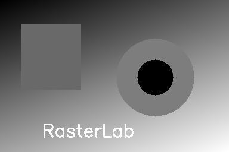

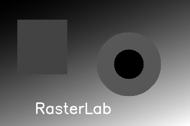

Гамма 1,5 затемняет средние тона. Полная цветовая информация при преобразовании в серый теряется, но форма объектов сохраняется.

### Морфология

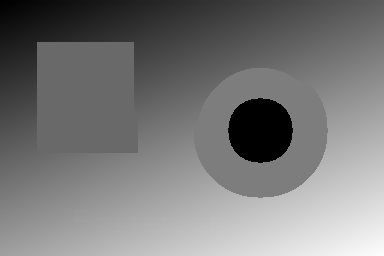

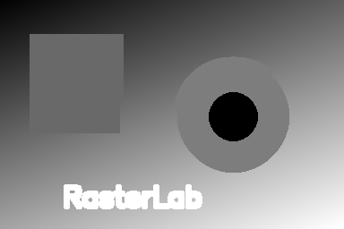

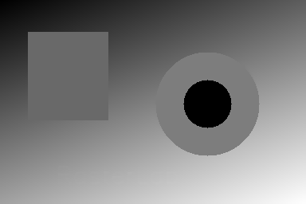

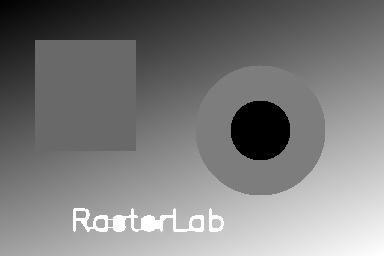

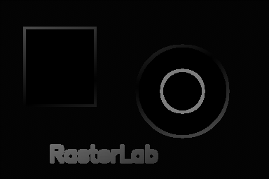

Эрозия сужает светлые области, дилатация расширяет их. Открытие подавляет мелкие светлые детали, закрытие — тёмные. Градиент выделяет переходы интенсивности.

### Фильтры

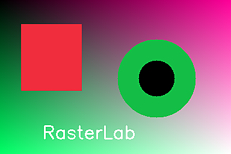

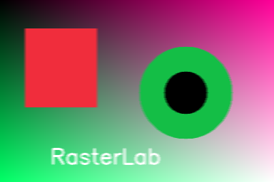

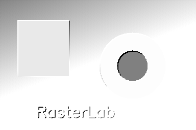


Резкость повышает локальный контраст на переходах, но может усиливать шум. Линейное ядро имитирует смазывание вдоль направления движения. Тиснение подчёркивает направленные перепады. Медианный фильтр подавляет импульсные выбросы и может удалять тонкие детали.

### Границы и ключевые точки

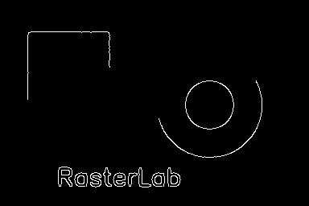

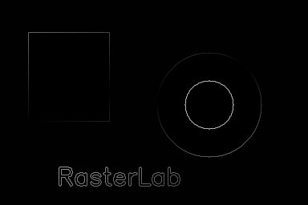

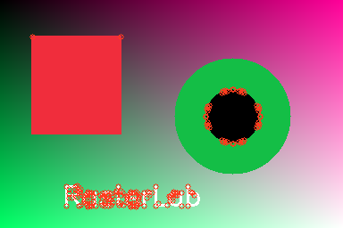

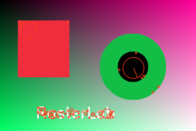

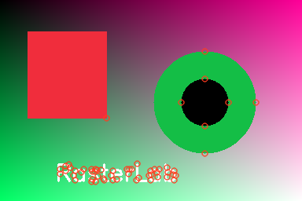

Canny даёт тонкие границы после подавления немаксимумов; Робертс отображает величину диагональных перепадов. Ключевые точки концентрируются на углах, тексте и характерных деталях.

### Видео

Для демонстрации создан `examples/motion.avi`: 150 кадров, 25 FPS, 384×256, первые 40 кадров — фон, затем движется полосатый прямоугольник. Ниже показаны исходный кадр №91 и результаты потоковой обработки исходных кадров до сжатия AVI.

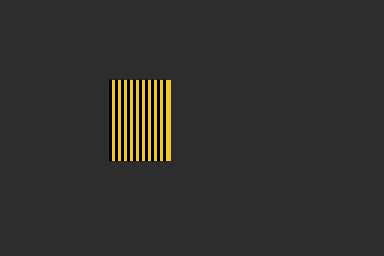

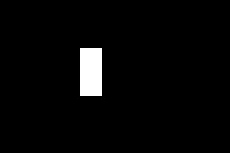


Объект выделяется маской, структура полос внутри движущейся области сглаживается. Отдалённый неподвижный фон сохраняется.

## 14. Порядок проверки в GUI

1. Открыть `examples/depth_24.png`, проверить разрешение 384×256 и глубину 24 бит.
2. По очереди открыть варианты `depth_*`, сравнить глубину и размер файла.
3. Кликнуть по изображению; проверить координаты и переводы RGB в остальные модели. Ввести вручную, например, HSV=(0,100,100): RGB должен быть (255,0,0).
4. На вкладке изображения изменить яркость, контраст и насыщенность. Нажать «Применить», сравнить обе гистограммы и переключить R/G/B.
5. Проверить серое изображение, линейную и нелинейную коррекцию. Для независимого опыта каждый раз сбрасывать результат.
6. Выполнить все пять морфологических операций, фильтры резкости, движения, тиснения, медианы, Canny, Робертса.
7. Выполнить Харрис, SIFT, FAST; проверить наложение и число точек.
8. Выполнить «Контуры»; изучить дерево в отдельном окне.
9. Выбрать `depth_24.png`, `similar.png`, `different.png` на вкладке сравнения. Изучить лучшую пару и расстояние.
10. Открыть `motion.avi`, дождаться появления объекта, переключить маску/размытие; проверить паузу и запуск с начала.
11. Сохранить результат в PNG и повторно открыть его.

## Заключение

Разработано приложение, реализующее обе практические группы задач: обработку растровых изображений и анализ движения в видео. Эксперимент показывает различие между глубиной кодирования, фактическим числом цветов и размером сжатого файла. Рассмотрены преобразования шести цветовых моделей, методы коррекции, морфология, контуры и локальные признаки. Реализованы воспроизводимые примеры и автоматические проверки вычислительной части.

## Источники

1. OpenCV: документация обработки изображений — https://docs.opencv.org/4.x/d7/dbd/group__imgproc.html
2. OpenCV: локальные признаки — https://docs.opencv.org/4.x/da/d9b/group__features2d.html
3. OpenCV: вычитание фона — https://docs.opencv.org/4.x/d1/dc5/tutorial_background_subtraction.html
4. Pillow: режимы изображений — https://pillow.readthedocs.io/en/stable/handbook/concepts.html
5. CSS Color 4: sRGB, Lab и преобразования — https://www.w3.org/TR/css-color-4/
6. Lowe D. G. Distinctive Image Features from Scale-Invariant Keypoints. IJCV, 2004.
7. Bay H. et al. Speeded-Up Robust Features (SURF). CVIU, 2008.
8. Rosten E., Drummond T. Machine Learning for High-Speed Corner Detection. ECCV, 2006.
